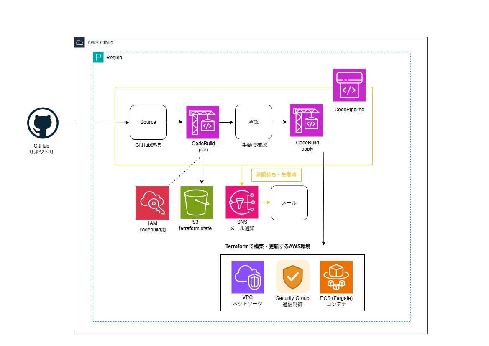

# AWS CI/CD Pipeline for Terraform

TerraformコードをGitHubにpushするだけで、AWSへ自動デプロイされる仕組みの研究用リポジトリです。

## 構成図



## 全体の流れ

```
GitHub (push) → CodePipeline
                 ├─ Source
                 ├─ Plan   (CodeBuild: terraform plan)
                 ├─ Approval (手動承認)
                 └─ Apply  (CodeBuild: terraform apply)
                       ↓
                 AWS (VPC / Security Group / ECS Fargate)

承認待ち・失敗時 → SNS → メール通知
```

## フォルダ構成

| フォルダ | 内容 |
|---|---|
| `bootstrap/` | Terraform state用のS3バケットを作成（最初に1回だけ手動） |
| `pipeline/` | CodePipeline / CodeBuild / SNS / IAMロールを作成（1回だけ手動） |
| `terraform-cicd/` | デプロイ対象（VPC, SG, ECS Fargate）。pipelineが自動実行 |

## 使い方

1. `bootstrap/` で `terraform apply`（stateバケット作成）
2. GitHubとAWSの接続（CodeConnections）を作成
3. `pipeline/terraform.tfvars` を作成して `terraform apply`
4. SNSの確認メールで **Confirm subscription**
5. 以降は `terraform-cicd/` を編集して `git push` するだけ
   - メールが届いたら承認 → 自動でApply

`terraform.tfvars` の例は `pipeline/terraform.tfvars.example` を参照。

## 注意点

- `terraform.tfvars` と `*.tfstate` はGitHubに上げない（`.gitignore`済み）
- `bootstrap/` は **destroyしない**（stateが消える）
- ECS Fargateはタスク起動中に課金されるため、検証後は `terraform destroy`
- IAMは最小権限（`cicd-research-*` のリソースのみ）

## 使用技術

Terraform / AWS CodePipeline / CodeBuild / SNS / ECS Fargate / S3 (state) / GitHub